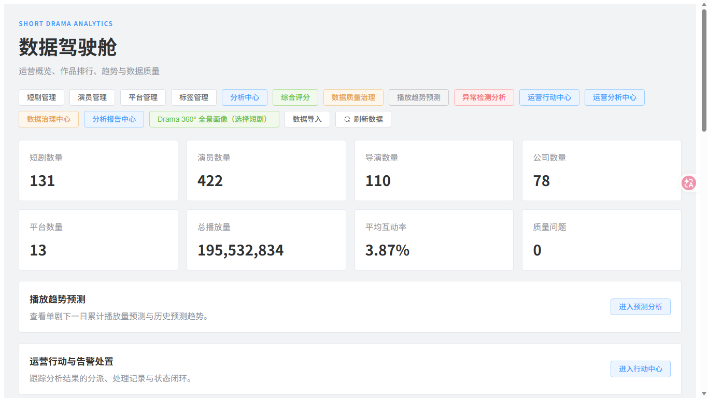
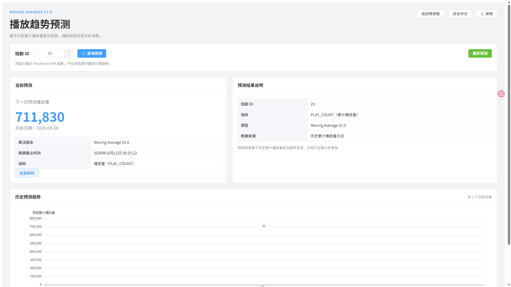
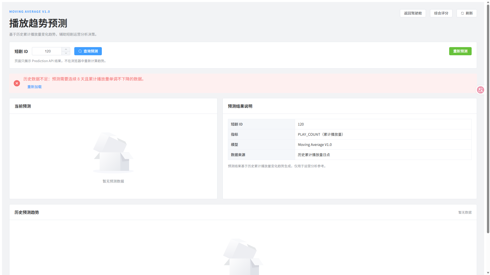
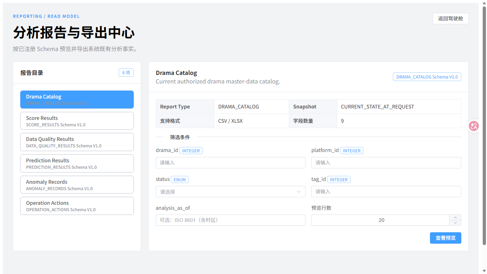

# Phase S5.2 UI/UX 审查报告

## 1. 方法与范围

2026-10-12 使用真实 Microsoft Edge（Chromium/CDP）登录现有 Vue 应用，通过专用 Vite 代理访问隔离后端。检查分辨率为 1920×1080 与 1366×768，覆盖 Dashboard、短剧列表、Drama 360、综合评分、Data Quality、Prediction、Anomaly、Operation Action、Operation Analytics、Data Governance 和 Reports。

自动检查包含：页面级水平溢出、按钮边界、页面标题、业务 Alert、控制台错误和 HTTP 500。最终轮次结果为：页面级水平溢出 0、控制台错误 0、HTTP 500 为 0。长页面中位于首屏以下的按钮属于正常纵向滚动，不判定为遮挡。

## 2. 已修复问题

| 编号 | 类型 | 修复 |
|---|---|---|
| S5.2-002 | 交互/文案 | Data Quality 当前评分 404 改为正常空状态；无活动规则显示中文业务原因。 |
| S5.2-003 | 交互/文案 | Prediction 最新结果 404 不再误报；`INSUFFICIENT_HISTORY` 显示连续 8 日与累计播放量单调条件。 |
| S5.2-004 | 布局 | 1366×768 下 Dashboard 导航移至标题下方，标题不再被挤成三行。 |
| S5.2-009 | 文案 | Data Quality 四维名称和页面眉题改为中文，内部枚举与模型版本保持不变。 |

修复前 Dashboard 标题受到挤压；修复后证据：

Prediction 正常与不足场景：

## 3. 已确认但未直接修改

| 编号 | 严重度 | 分类 | 观察 | 处理 |
|---|---|---|---|---|
| S5.2-006 | P2 | 性能/交互 | Dashboard 单接口实测约 8.1～15.7 秒，完整首屏需约 19 秒；加载状态存在，但人工验收需耐心等待。 | 需要 SQL 执行计划与性能目标，不在本阶段修改算法或索引。 |
| S5.2-007 | P3 | 文案 | Reports 目录/描述、Anomaly 类型与证据、Profile 字段、Governance 规则名仍有中英文混用。 | 内部标识需兼容；统一展示词典属于后续产品文案任务。 |
| S5.2-010 | P3 | 交互 | 综合评分页默认当天，现有评分只在 2026-09-07，初次进入显示空。 | 是否默认最新评分日涉及产品语义，等待确认。 |
| S5.2-011 | P3 | 视觉 | 1366 宽度导航入口较多，修复后可读但仍占两行。 | 若要重组导航，属于整体信息架构调整，等待确认。 |

Reports 混合语言证据：

## 4. 页面结果摘要

| 页面 | 1920×1080 | 1366×768 | 结果 |
|---|---|---|---|
| Dashboard | 已截图 | 已截图 | 无水平溢出；响应式缺陷已修复；加载偏慢。 |
| Data Quality | 空状态/失败提示均截图 | 已截图 | 无规则时说明准确。 |
| Prediction | 25 成功、120 空/不足均截图 | 25 已截图 | 图表与实际 API 数据一致。 |
| Drama/Profile | 已截图 | 未补充 | 聚合只读，空模块状态清楚。 |
| Anomaly/Actions | 已截图 | 未补充 | 列表与状态统计一致。 |
| Operation Analytics | 已截图 | 未补充 | 明确声明非因果结论。 |
| Data Governance | 已截图 | 未补充 | Freshness/Completeness/Consistency 与 Data Quality 评分分开。 |
| Reports | 已截图 | 已截图 | Preview 可用；英文目录待本地化。 |

所有截图位于 `docs/acceptance/evidence/phase_s5_2/`，不含账号、密码或 Token。
